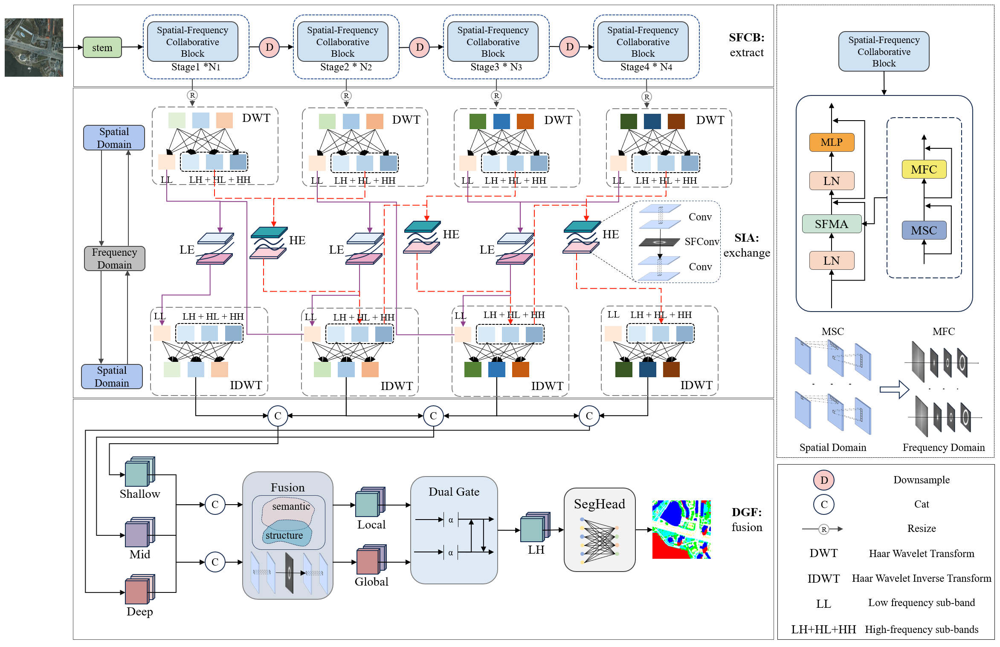
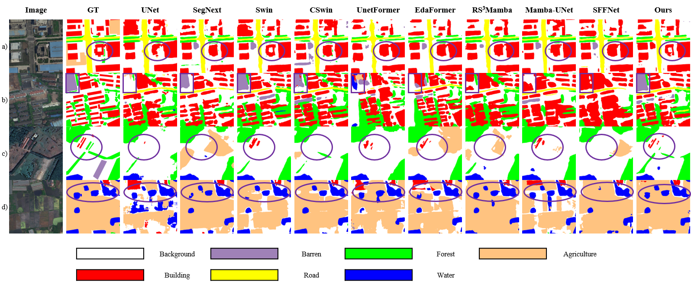
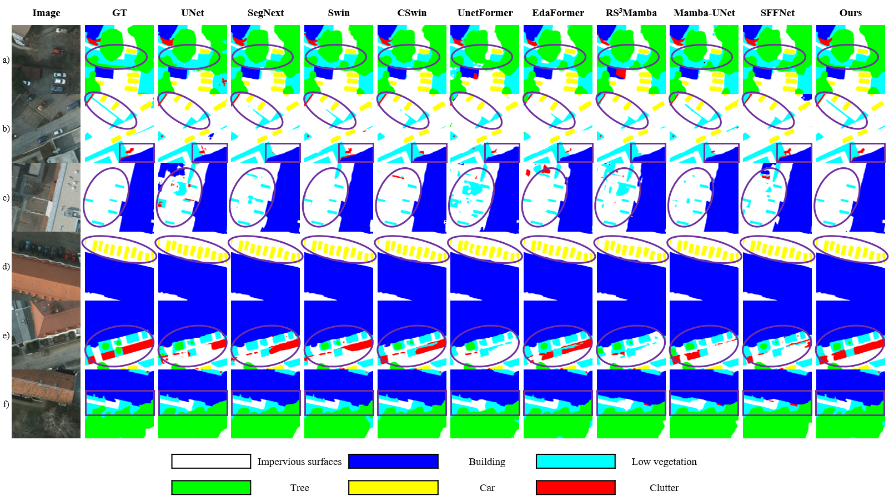
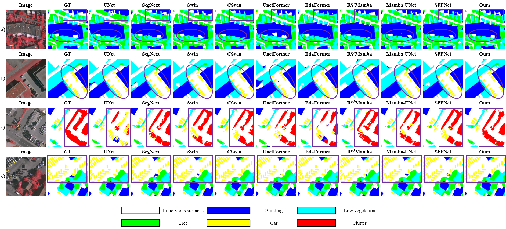

# SFMNet: Joint Semantic and Structural Modeling via Spatial-Frequency Collaboration for Remote Sensing Scene Segmentation

The repository contains the official PyTorch implementations of training and evaluation codes and pre-trained models for **SFMNet**.

The code is based on [MMSegmentation v0.24.1](https://github.com/open-mmlab/mmsegmentation/tree/v0.24.1).

## Updates

- **[2025.06]** Code and pre-trained models on LoveDA and Potsdam are released.

## Summary

**SFMNet** is a spatial-frequency collaborative network for high-resolution remote sensing scene segmentation that jointly models global semantic context and local structural boundaries through cross-scale spatial-frequency interaction and dual-gate fusion. It achieves state-of-the-art mIoU and boundary mIoU on ISPRS Potsdam, Vaihingen, and LoveDA.

## Architecture



## Experimental Results

Each category is reported as IoU|BIoU (%). **Bold** indicates the best result and † indicates the second-best result.

### Table 1. Quantitative comparison on the Potsdam val set

| Methods | Imp. Surf. | Building | Low Veg. | Tree | Car | Clutter | mIoU | BmIoU | OA | F1 | Precision | Recall |
| :-- | :-- | :-- | :-- | :-- | :-- | :-- | :--: | :--: | :--: | :--: | :--: | :--: |
| ABCNet | 84.54\|33.60 | 93.20\|78.01 | 75.38\|66.83 | 74.01\|51.51 | 81.07\|84.53 | 51.44\|39.92 | 76.61 | 59.06 | 89.55 | 86.10 | 86.78 | 85.50 |
| SegNeXt | 87.16†\|37.44 | 94.79†\|82.91 | 78.46\|71.38 | 77.63†\|56.85† | 84.57\|87.64 | 58.73\|47.89 | 80.22† | 63.02 | 91.34 | 88.58 | 89.63 | 87.70 |
| Swin | 87.16\|37.00 | 94.69\|82.29 | 78.20\|71.40 | 77.05\|56.11 | 83.95\|87.10 | 58.35\|48.12 | 79.90 | 63.67 | 91.21 | 88.36 | 89.54 | 87.42 |
| CSwin | 86.99\|37.31 | 94.50\|82.38 | 78.24\|71.56 | 77.37\|56.57 | 84.59\|88.02 | 58.75†\|47.86 | 80.08 | 63.95 | 91.21 | 88.49 | 89.28 | 87.85 |
| UNetFormer | 85.01\|33.94 | 93.65\|79.45 | 75.75\|67.26 | 74.72\|52.29 | 81.78\|85.02 | 53.93\|40.87 | 77.47 | 59.80 | 89.95 | 86.73 | 87.90 | 85.79 |
| RS³Mamba | 85.43\|34.24 | 93.79\|79.85 | 76.31\|67.96 | 74.97\|52.86 | 81.90\|85.04 | 53.66\|40.66 | 77.68 | 60.10 | 90.15 | 86.85 | 88.24 | 85.74 |
| SFFNet | 86.77\|**39.15** | 94.54\|82.51† | 77.48\|72.33† | 76.43\|56.82 | 84.63\|**89.40** | 58.38\|51.25† | 79.70 | 65.21† | 90.97 | 89.32† | 90.39† | 88.48† |
| **SFMNet (Ours)** | **87.87**\|38.80† | **95.04**\|**83.87** | **79.39**\|**72.58** | **78.56**\|**58.91** | **85.45**\|88.61 | **61.84**\|50.00† | **81.36** | **65.46** | **91.71** | **89.34** | **90.40** | **88.50** |

### Table 2. Quantitative comparison on the Vaihingen val set

| Methods | Imp. Surf. | Building | Low. Veg. | Tree | Car | Clutter | mIoU | BmIoU | OA | F1 | Precision | Recall |
| :-- | :-- | :-- | :-- | :-- | :-- | :-- | :--: | :--: | :--: | :--: | :--: | :--: |
| ABCNet | 79.81\|28.60 | 86.57\|72.64 | 63.70\|51.75 | 73.79\|63.67 | 59.04\|65.74 | 37.06\|33.22† | 66.66 | 52.60 | 86.17 | 78.77 | 85.47 | 75.80 |
| SegNeXt | 81.69\|**31.71** | **89.25**\|**77.60** | 67.11\|56.36 | 75.90†\|**66.94** | 68.96†\|75.45 | 31.62\|27.35 | 69.09 | 55.90 | 87.78 | 80.09 | 88.10† | 77.22 |
| Swin | 81.59\|29.73 | 88.54\|74.89 | 66.55\|54.83 | 75.10\|65.00 | 66.63\|74.11 | 31.82\|28.03 | 68.37 | 54.43 | 87.45 | 79.62 | 87.53 | 76.85 |
| CSwin | **82.47**\|31.06† | 89.05\|75.97 | 67.73\|56.94 | 75.56\|66.33 | 67.99\|**76.12** | 34.93\|31.77 | 69.62† | 56.37† | 87.93 | 80.69† | 87.60 | 78.17† |
| UNetFormer | 80.46\|28.69 | 87.31\|73.33 | 64.53\|52.99 | 74.29\|64.03 | 61.00\|67.35 | 33.02\|28.21 | 66.77 | 52.43 | 86.60 | 78.59 | 86.42 | 75.50 |
| RS³Mamba | 80.04\|28.66 | 87.25\|73.37 | 65.39\|53.20 | 74.96\|64.43 | 61.59\|67.01 | 34.85\|30.60 | 67.34 | 52.88 | 86.76 | 79.13 | 86.96 | 75.71 |
| SFFNet | 81.39\|30.90 | 88.80\|76.85† | 66.71\|55.41 | 75.38\|65.97 | 67.64\|74.10 | 36.83†\|33.13 | 69.46 | 56.06 | 87.53 | 80.72 | 87.48 | 77.88 |
| **SFMNet (Ours)** | 82.25†\|30.79 | 89.09†\|76.21 | **67.96**\|**57.20** | 75.80\|65.86 | **68.99**\|75.83† | **37.15**\|**34.26** | **70.21** | **56.69** | **87.97** | **81.25** | 87.84 | **78.45** |

### Table 3. Quantitative comparison on the LoveDA val set

| Methods | Back. | Building | Road | Water | Barren | Forest | Agri. | mIoU | BmIoU | OA | F1 | Precision | Recall |
| :-- | :-- | :-- | :-- | :-- | :-- | :-- | :-- | :--: | :--: | :--: | :--: | :--: | :--: |
| ABCNet | 52.59\|16.56 | 57.41\|58.21 | 53.09\|44.74 | 64.57\|53.16 | 21.46\|14.16 | 40.24\|31.15 | 56.14\|38.68 | 49.36 | 36.67 | 69.31 | 64.91 | 71.71 | 61.36 |
| SegNeXt | 52.92\|16.97 | 65.26\|67.90 | 58.76†\|50.15 | 71.80\|57.84 | 28.74\|18.21 | 41.96\|35.08 | 61.01†\|44.33 | 54.35 | 41.50 | **72.17** | 69.34 | 74.56 | 66.75 |
| Swin | 53.18\|17.72 | 64.33\|69.62 | 56.98\|49.30 | 72.35\|59.92 | 26.07\|17.33 | 42.91\|36.01 | 51.82\|37.95 | 52.52 | 41.12 | 70.31 | 67.71 | 74.51 | 64.77 |
| CSwin | 53.14\|17.21 | 65.11\|70.81 | **59.19**\|**50.72** | 71.35\|58.81 | 33.42†\|24.37† | 43.98\|37.93 | 57.34\|41.78 | 54.79† | 43.09 | 71.60 | 70.00† | 73.54 | 67.92† |
| UNetFormer | 52.12\|16.36 | 56.57\|59.71 | 53.34\|44.70 | 65.00\|54.00 | 21.99\|14.08 | 38.60\|30.45 | 51.80\|36.39 | 48.49 | 36.53 | 68.12 | 64.16 | 71.85 | 60.74 |
| RS³Mamba | 49.87\|15.57 | 60.99\|64.38 | 57.11\|48.97 | 70.32\|57.12 | 26.80\|16.92 | 40.78\|34.25 | 59.67\|44.03 | 52.22 | 40.18 | 70.33 | 67.51 | 72.29 | 64.85 |
| SFFNet | 49.97\|15.50 | 63.12\|65.70 | 57.12\|49.76 | 71.52\|57.37† | 31.86\|20.52 | 43.94\|35.45 | 58.41\|41.49 | 53.71 | 40.83 | 70.68 | 69.04 | 72.81 | 67.04 |
| **SFMNet (Ours)** | 51.94\|16.94 | 64.52\|70.02 | 56.56\|50.61† | **72.54**\|**59.61** | **35.92**\|**27.02** | 44.62\|**39.24** | **60.30**†\|**44.34**† | **55.20** | **43.94** | 71.92† | **70.42** | 72.38 | **69.04** |

## Visualization

**LoveDA**



**Potsdam**



**Vaihingen**



## Model Download

| Dataset | mIoU (%) | Config | Weights (Baidu Drive) | Weights (Google Drive) |
| :-----: | :------: | :----: | :-------------------: | :--------------------: |
| Potsdam | 81.36 | [config](local_configs/versus/potsdam/SFMNet.512x512.potsdam.160k.py) | [Coming Soon](#) | [Coming Soon](#) |
| Vaihingen | 70.21 | [config](local_configs/versus/vaihingen/SFMNet.512x512.vaihingen.160k.py) | [Coming Soon](#) | [Coming Soon](#) |
| LoveDA | 55.20 | [config](local_configs/versus/loveda/SFMNet.512x512.loveda.160k.py) | [Coming Soon](#) | [Coming Soon](#) |

> Download links will be updated soon. Config files are included in this repository.

## Quick Start

This guide will help you set up the environment and run training / evaluation on ISPRS Potsdam, Vaihingen, and LoveDA.

### 1. Installation

#### Clone the repository

```bash
git clone https://github.com/klifaxxw/SFMNet.git
cd SFMNet
```

#### Install dependencies

Create and activate a virtual environment (optional):

```bash
conda create -n sfmnet python=3.8
conda activate sfmnet
```

or use Python's built-in **venv**:

```bash
python -m venv sfmnet
source sfmnet/bin/activate    # Linux / Mac
# sfmnet\Scripts\activate     # Windows
```

Install project dependencies:

```bash
pip install -r requirements.txt
```

Install [pytorch_wavelets](https://github.com/fbcotter/pytorch_wavelets) (required by the HLFT decoder):

```bash
cd mmseg/core/pytorch_wavelets
pip install -e .
cd ../../..
```

Install this repository:

```bash
pip install -e .
```

### 2. Prepare Dataset

#### ISPRS Potsdam & Vaihingen

- Download from the [ISPRS 2D Semantic Labeling Contest](https://www.isprs.org/education/benchmarks/UrbanSemLab/default.aspx).
- Organize each dataset as follows and update `data_root` in [`local_configs/_base_/datasets/potsdam.py`](local_configs/_base_/datasets/potsdam.py) / [`vaihingen.py`](local_configs/_base_/datasets/vaihingen.py):

```
potsdam/  (or vaihingen/)
├── img_dir/
│   ├── train/
│   └── val/
└── ann_dir/
    ├── train/
    └── val/
```

#### LoveDA

- Download from the [LoveDA official page](https://codalab.lisn.upsaclay.fr/competitions/421).
- Update `data_root` in [`local_configs/_base_/datasets/loveda.py`](local_configs/_base_/datasets/loveda.py):

```
loveda/
├── img_dir/
│   ├── train/
│   └── val/
└── ann_dir/
    ├── train/
    └── val/
```

### 3. Training

We use **2 GPUs** by default. To train on Potsdam, run:

```bash
./tools/dist_train.sh local_configs/versus/potsdam/SFMNet.512x512.potsdam.160k.py 2
```

To train on Vaihingen, run:

```bash
./tools/dist_train.sh local_configs/versus/vaihingen/SFMNet.512x512.vaihingen.160k.py 2
```

To train on LoveDA, run:

```bash
./tools/dist_train.sh local_configs/versus/loveda/SFMNet.512x512.loveda.160k.py 2
```

#### Parameter Explanation

| Parameter | Type | Description | Required |
| :-- | :-- | :-- | :--: |
| config | string | Path to the training config file | ✅ |
| GPUS | int | Number of GPUs for distributed training (default: 2) | ✅ |

You can create your own config by using [`local_configs/versus/potsdam/SFMNet.512x512.potsdam.160k.py`](local_configs/versus/potsdam/SFMNet.512x512.potsdam.160k.py) as a template.

### 4. Evaluation

Evaluate on **Potsdam**:

```bash
./tools/dist_test.sh local_configs/versus/potsdam/SFMNet.512x512.potsdam.160k.py \
  /path/to/potsdam_checkpoint.pth 2 --eval mIoU
```

Evaluate on **Vaihingen**:

```bash
./tools/dist_test.sh local_configs/versus/vaihingen/SFMNet.512x512.vaihingen.160k.py \
  /path/to/vaihingen_checkpoint.pth 2 --eval mIoU
```

Evaluate on **LoveDA**:

```bash
./tools/dist_test.sh local_configs/versus/loveda/SFMNet.512x512.loveda.160k.py \
  /path/to/loveda_checkpoint.pth 2 --eval mIoU
```

#### Parameter Explanation

| Parameter | Type | Description | Required |
| :-- | :-- | :-- | :--: |
| config | string | Path to the config file | ✅ |
| checkpoint | string | Path to the trained checkpoint (`.pth`) | ✅ |
| GPUS | int | Number of GPUs for distributed testing (default: 2) | ✅ |
| `--eval mIoU` | flag | Compute mean IoU on the validation set | ✅ |

## Citation

If you find our repo useful for your research, please consider citing our paper:

```
@article{sfmnet,
  title   = {SFMNet: Joint Semantic and Structural Modeling via Spatial-Frequency Collaboration for Remote Sensing Scene Segmentation},
  author  = {},
  journal = {},
  year    = {}
}
```

## Acknowledgement

Our implementation is mainly based on [MMSegmentation v0.24.1](https://github.com/open-mmlab/mmsegmentation/tree/v0.24.1). Thanks for their authors.

We also thank [SegNeXt](https://github.com/Visual-Attention-Network/SegNeXt), [SFFNet](https://github.com/yysdck/SFFNet), and [CSWin](https://github.com/microsoft/CSWin-Transformer) for the inspiration from their code and papers.

## Contact

For technical problems, please create an issue.

If you have any private question, please feel free to contact me via X1308567250@gmail.com.

## LICENSE

This repo is under the Apache-2.0 license. For commercial use, please contact the authors.
